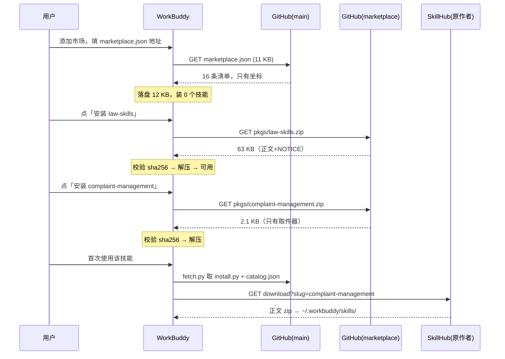

# 架构与原理

> 这份文档回答两个问题：**这个仓库是什么、为什么长这样**，以及**WorkBuddy 的「技能套件市场」到底怎么工作**。
> 写给两个人看：未来的我，和接手这个仓库的 AI 助手。事实以 2026-11-13、WorkBuddy 5.11.3 实测为准。

---

## 0. 怎么读

| 你是 | 读哪几节 |
|---|---|
| 第一次接触这个仓库 | 1 → 2 → 3 → 5 |
| 想搞懂「添加市场为什么只下载清单」 | 6 → 7 |
| 要改清单、加技能、发版 | 9 → 10 |
| 想知道某个奇怪设计为什么不改 | 11 决策日志 |
| AI 助手接手 | 0 → 3 → 11 → 13（13 是硬约束） |

---

## 1. 项目是什么

**awesome-financial-skills**：为金融从业者（消保、合规、公文、投研、数据）策展的 AI 技能清单。

它不是一个技能仓库，是**一张带坐标的目录**。仓库里没有一个技能的正文，只有 16 条「去哪儿取」的记录。

| 事实 | 值 |
|---|---|
| 收录条数 | 16 |
| 分类 | 声明 9 个，有内容 4 个（消费者保护 5 / 办公设计 5 / 数据技术 5 / 合规法务 1） |
| 来源 | 16 条全部 SkillHub（`source.type = "skillhub"`） |
| 许可 | MIT 3 条、proprietary 13 条 |
| 仓库体积 | main 分支 18 个文件，`catalog.json` 21 KB |
| 站点 | https://openfcp.github.io/awesome-financial-skills/ |

三条对外入口：

```
浏览/检索   →  GitHub Pages 静态站
终端安装   →  curl … | bash -s -- --all
WorkBuddy  →  技能 → 套件 → 添加市场（填 marketplace.json 的地址）
```

---

## 2. 三条硬规则

这三条是全部设计的前提，改动任何一条都会牵动后面所有环节。

### R1 · 零正文

仓库内任何位置出现清单未声明的 `SKILL.md`，**构建直接失败**。

不是为了洁癖。上一版把 17 个技能完整复制进 `plugins/`，10 MB、555 个文件，实测与 SkillHub 原件**字节级完全一致**——那 10 MB 全是搬运。代价是：作者更新后副本必然过期、正文版权不归清单作者、仓库会长成臃肿的镜像站。

守卫在 `scripts/build.py`：

```python
for md in ROOT.rglob("SKILL.md"):
    if any(part in ignore_dirs for part in md.parts):   # dist/ 等 gitignore 目录跳过
        continue
    rel = md.parent.resolve().relative_to(ROOT).as_posix()
    if rel in vendored or rel.startswith(".git") or rel.split("/")[0] in own_code:
        continue
    fail(f"仓库内出现未声明的技能正文：{rel}/SKILL.md")
```

`vendored: true` 是留给「正文必须在本仓」的特例的逃生舱——显式声明 + 构建校验目录真实存在。**当前没有任何一条用到它**（唯一用过的那条 `official-source-qa` 已于 2026-11-13 删除）。

### R2 · 单一真相源

`catalog.json` 是唯一真相源。站点数据（`docs/catalog.js`）、市场清单（`marketplace.json`）、安装行为，全部由它派生。手改派生文件会被下一次构建覆盖。

### R3 · 按许可分流

**未获再分发许可的正文不进本仓**，无论以什么形式（raw 文件、zip、base64）。

这是 R1 的延伸，但更硬：R1 管的是「仓库源码树」，R3 管的是「我们对外分发的任何产物」，包括市场包。

---

## 3. 核心抽象：坐标与正文

整个项目只有一个概念：**清单存坐标，正文在别处，消费端按规则去取**。

```
catalog.json（坐标）
   │  source.type = "skillhub"  →  https://api.skillhub.cn/api/v1/download?slug={slug}
   │  source.type = "github"    →  raw / api / jsDelivr 三通道按目录取文件
   ▼
原作者手上的正文（永不复制进本仓）
```

坐标有两种：

| 类型 | 坐标是什么 | 取回方式 |
|---|---|---|
| `skillhub` | `namespace` + `slug` | GET 一个 zip，解压后 `SKILL.md` 在根 |
| `github` | `repo` + `path` + `ref` | 按目录逐文件取，raw → api → jsDelivr |

取回规则**写在清单里**（`resolve` 块），不硬编码在消费端——这样第三方（比如 dsh 插件）也能读懂这张清单，不必跟着仓库改代码：

```json
"resolve": {
  "skillhub": { "kind": "zip",   "url": "https://api.skillhub.cn/api/v1/download?slug={slug}" },
  "github":   { "kind": "files", "raw": "https://raw.githubusercontent.com/{repo}/{ref}/{path}",
                 "api": "https://api.github.com/repos/{repo}/contents/{path}?ref={ref}" }
}
```

占位符用 `str.format` 语义替换，未知占位符保持原样。

---

## 4. 清单格式（format 3）

```json
{
  "id": "consumer-protection-review",
  "name":    { "zh": "消保审查", "en": "Consumer Protection Review" },
  "summary": { "zh": "…", "en": "…" },
  "category": "consumer-protection",
  "version": "1.0.0",
  "author": "八大权益",
  "license": "proprietary",
  "source": { "type": "skillhub", "namespace": "user_e3180ba3", "slug": "consumer-protection-review" },
  "install": { "skillhub": "skillhub install consumer-protection-review --namespace user_e3180ba3" }
}
```

字段职责，几个容易搞错的：

| 字段 | 作用 | 注意 |
|---|---|---|
| `id` | 本仓库的索引键 | **不等于**装出来的目录名 |
| `name.zh` | 显示名 | 也不等于目录名 |
| `version` | 策展时记录的版本 | 仅展示；实际装到的是作者当前发布版 |
| `source` | 坐标 | 消费端唯一依赖的字段 |
| `install` | 人读的安装命令 | 站点卡片直接显示 |

目录名规则见 §5.B：**取 `SKILL.md` 的 `name`**，与 `id` 无关（例：`id: ai-ppt-skill` → 装出来是 `ppt-master`）。`schema.json` 是这份格式的 JSON Schema，`build.py` 做更严的语义校验（分类命中、双语非空、source 字段完整性）。

---

## 5. 三条消费链路

### A. 静态站（GitHub Pages）

```
catalog.json ──build.py──▶ docs/catalog.js (window.__CATALOG__) ──▶ docs/index.html
```

`index.html` 单文件、无外部依赖，`file://` 也能打开。构建时给 `catalog.js?v=<内容指纹>` 打戳——GitHub Pages 发 `Cache-Control: max-age=600`，不打戳就会出现「改了清单页面没变」的假故障。

九类筛选之外，每张卡有一键复制：装命令（SkillHub CLI）或市场地址。

### B. 终端安装（install.sh → install.py）

```bash
curl -fsSL .../main/install.sh | bash -s -- --all
```

`install.sh` 只做三件事：取 `install.py`、取 `catalog.json`、交给 python 跑。真正的逻辑在 `scripts/install.py`，它按 `source.type` 调对应的 resolver，落到 `~/.workbuddy/skills/<name>/`。

五条行为约定，都是踩过坑定下来的（**别改回去**）：

| 约定 | 为什么 |
|---|---|
| 目录名取 `SKILL.md` 的 `name` | WorkBuddy 按 `name` 触发技能；目录名不一致时列表里看得到、调用不到 |
| 下载失败就失败，不装空壳 | 空壳能列出来但一调用就错，比装不上难排查得多 |
| token 只发给 `api.github.com` | 曾把 token 带到 jsDelivr，被平台判成凭证泄漏 |
| 每次取最新原件 | 仓库里的副本一旦存在就必然过期 |
| raw 优先，jsDelivr 兜底 | jsDelivr 把 `@main` 缓存十几小时，只认它会拿到旧清单 |

### C. WorkBuddy 市场（本文重点）

见 §6、§7。

---

## 6. WorkBuddy 插件市场的运行原理

> 本节是读源码 + 本机实测得出的结论，对应 WorkBuddy 5.11.3。升级后若有出入，以源码为准；结论的**方向**（整包市场 vs 清单市场）不会变。

### 6.1 落盘位置与状态文件

```
~/.workbuddy/plugins/
├── known_marketplaces.json      # 已添加的市场源登记表
├── installed_plugins.json       # 已安装的插件（按 市场名 分组，记 installPath / version）
├── configured-plugins.json      # 启用状态与配置
├── cache/<市场>/<插件>/<版本>/   # 真正装下来的插件正文
└── marketplaces/<市场名>/        # 市场的「本地副本」
    └── .codebuddy-plugin/marketplace.json
```

关键点：`marketplaces/<市场名>/` 里放**多少东西，取决于市场源的类型**。这是整件事的分水岭。

`known_marketplaces.json` 一条记录长这样：

```json
"workbuddy-wecom-unified": {
  "type": "zip",
  "source": { "source": "zip", "path": "https://…/wecom-unified.zip", "url": "https://…" },
  "installLocation": "…/marketplaces/workbuddy-wecom-unified",
  "autoUpdate": true, "isBuiltIn": true
}
```

### 6.2 市场源类型 → 下载行为

添加市场时可填的源，按源码分支归纳为七类。**它们的区别不在能不能用，而在于「添加的那一刻下载什么」**：

| 市场源类型 | 你填什么 | 添加时下载 | 本地占地 |
|---|---|---|---|
| `directory` / 字符串路径 | 本地目录 | 不下载，直接挂本地目录 | 0（引用） |
| `zip` / `archive` | http(s) 的 zip | **整个 zip，含全部插件正文** | 大 |
| `github` / `url` / `git-subdir` | `owner/repo`、git 地址、仓库子目录 | **git clone 整仓** | 大 |
| `npm` / `pip` | 包名 | 下载整包 | 中 |
| `provider` | 应用内已注册的 provider 名 | **只有一份 marketplace.json** | 极小 |

实测本机五类市场的磁盘占用，差异一目了然：

| 市场 | 类型 | 磁盘占用 | 说明 |
|---|---|---|---|
| `workbuddy-connector-plugins-official` | provider | **1.2 MB**（1 个文件：803 条清单） | 正文按需下载 |
| `awesome-financial-skills`（本仓） | 远程清单 → 每条 `archive` | **12 KB**（1 个文件：16 条清单） | 正文按需下载 |
| `cb_teams_marketplace` | zip | 13 MB | 整包 |
| `codebuddy-plugins-official` | zip | 46 MB | 整包，206 个插件正文全在本地 |
| `workbuddy-wecom-unified` | zip | 44 MB | 整包 |

**这就是「填地址 → 显示清单 → 点选才下载」能不能实现的全部答案**：只有当清单里**每条插件自带一个可独立下载的地址**时，添加市场才只需要那份清单。

### 6.3 清单校验规则

`marketplace.json` 的最小要求很松：

```json
{ "name": "市场名", "plugins": [ { "name": "插件名", "source": … } ] }
```

- 必需：市场 `name`、`plugins` 数组；每条插件 `name` + `source`。
- 缺失时报 `Missing or invalid required field: plugins`。
- 其余字段（`description` / `version` / `category` / `author` / `homepage` / `license`）全是展示用，可以省。

由于列表本身不校验正文是否存在，**清单可以指向一个此刻还不存在的包**——这正是"先列清单、后下载"的物理基础。

### 6.4 插件 `source` 类型 → 安装动作

清单里单条插件的 `source` 决定点「安装」时发生什么：

| 插件 source | 安装动作 | 备注 |
|---|---|---|
| 字符串 `"./plugins/x"` | 从市场本地副本复制该目录 | 正文必须在市场包里，故市场只能整包下载 |
| `{"source":"archive","url":…,"sha256":…}` | 下载该 zip，**校验 sha256 后**解压 | sha256 必须精确匹配；包内需有 `.codebuddy-plugin/plugin.json` |
| `{"source":"github"…}` | git clone / 取仓库子目录 | 适合作者自己的仓库 |
| `{"source":"provider","provider":…,"sha256":…}` | 交给应用内注册的 provider 实现去取 | 连接器专用，第三方无法自制 |

**`archive` 是我们能用的关键**：它允许「每条插件一个独立 URL + 强校验」，且不需要应用内注册任何东西。

### 6.5 官方是怎么做的（对照）

`workbuddy-connector-plugins-official` 是 provider 型，磁盘上只有一个 1.2 MB 的 `marketplace.json`，803 条：

```json
{
  "name": "tdx-connector",
  "version": "0.0.0+wb.d18fdc3baf84cae3",
  "source": { "source": "provider", "provider": "workbuddy-connector-plugins-official",
              "sha256": "c8e48455…" }
}
```

每条只有坐标 + sha256，没有正文。**我们的 `marketplace.json` 是同一个形状**，只是把 `provider` 换成了 `archive`——因为 `provider` 需要应用内注册实现，第三方用不了。

---

## 7. 我们的市场实现

### 7.1 分支分工

```
main 分支（源码，18 个文件）
  catalog.json          坐标清单（唯一真相源）
  marketplace.json      市场清单（16 条 archive 源，11 KB）
  scripts/*.py          取回 / 打包 / 发布
  docs/                 静态站

marketplace 分支（构建产物，只有 zip，不进 main）
  pkgs/<id>.zip         16 个包，合计 2.0 MB
```

为什么分两个分支：包是构建产物、体积会涨、且不该出现在源码树的任何遍历里（R1 守卫会把 `dist/` 当正文）。用分支做分发，`main` 永远保持 20 KB 量级。

`marketplace.json` 里每条：

```json
{
  "name": "consumer-protection-review",
  "description": "…",
  "version": "1.0.0",
  "category": "consumer-protection",
  "author": { "name": "八大权益" },
  "homepage": "https://skillhub.cn/skills/consumer-protection-review",
  "license": "proprietary",
  "source": {
    "source": "archive",
    "url": "https://raw.githubusercontent.com/openfcp/awesome-financial-skills/marketplace/pkgs/consumer-protection-review.zip",
    "sha256": "7e0ac2b7…"
  }
}
```

### 7.2 许可分流：镜像包 vs 取件器

R3 说「未授权正文不进本仓」，但市场里的包**就在本仓的分支上**。于是按许可分两路（`scripts/pack_market.py`）：

```python
REDISTRIBUTABLE = {"mit","apache-2.0","bsd-2-clause","bsd-3-clause","isc","mpl-2.0","cc0-1.0","unlicense"}
```

| | 镜像包 | 取件器 |
|---|---|---|
| 条件 | `license` ∈ 白名单 | 其余（含 `proprietary` / 未声明） |
| 条数 | 3（`aistockresearcher` / `smart-charts` / `law-skills`） | 13 |
| 包里是什么 | SkillHub 取回的正文 + `plugin.json` + `NOTICE.md` | 只有我们自己的 3 个文件：`plugin.json` / `SKILL.md` / `scripts/fetch.py` |
| 体积 | 63 KB / 960 KB / 983 KB | 约 2.1 KB |
| 点装后 | 立即可用，离线可用 | 首次使用时跑一次 `fetch.py` 现取正文 |
| 版权处理 | `NOTICE.md` 写明作者、原页面、许可、下架通道 | 包里没有任何他人正文 |

许可不明就按「未授权」处理——这是默认值，不是失败分支。

### 7.3 取件器怎么工作

```
点「安装」→ 下载 2 KB 的取件器包 → 解压到 cache/
   ├── .codebuddy-plugin/plugin.json   （让市场认出这是个插件）
   ├── SKILL.md                        （告诉模型：正文不在这里，先取件）
   └── scripts/fetch.py                （十几行：取 install.py + catalog.json → 执行 --only <id>）
        ↓ 用户首次调用
   从 SkillHub 取回作者当前版本 → ~/.workbuddy/skills/<name>/
```

`fetch.py` 刻意不自己实现下载逻辑，而是**取回仓库里的 `install.py` 再调用**——单一实现，避免两处漂移。代价是需要网络（第一次必然需要）。

时序（端到端）：



### 7.4 为什么不是别的三种做法

| 备选 | 为什么否掉 |
|---|---|
| 市场源直接填 `owner/repo`（github 型） | 会 clone 整仓；且正文一旦进仓就违反 R1/R3 |
| 市场用 zip 整包（官方那 206 个插件的做法） | 添加市场时下载全部正文——违反「只显示清单、不下载全部」的硬约束；早期 3 MB 整包就是这么来的，已废弃 |
| 清单里用 `provider` 源 | 需应用内注册实现，第三方用不了 |
| 清单只存"人读的说明"，靠对话告诉我装什么 | 用户明确否决：「如果是通过对话，我就不需要了」 |

---

## 8. 版权与下架

- 清单本身 MIT；各技能正文版权归各自作者。
- 13 条 `proprietary` 的正文**不在本仓任何位置**，取件器只是把我们自己的代码交给用户，取正文的动作发生在用户机器与原作者服务器之间。
- 3 条 MIT 镜像包内附 `NOTICE.md`：技能名、作者、原页面、namespace、许可证、清单版本，以及下架通道。
- 下架：issue 提一条 → 确认后 24 小时内删除对应包 + 清单条目（`pack_market.py --only` 重打、`publish_market.py` 整体替换会清掉旧包）。
- 免责：本清单是技术资源索引，不构成投资建议、法律意见或合规承诺。

---

## 9. 仓库结构与职责

```
catalog.json            唯一真相源：分类 + 16 条引用（双语、来源、安装方式、取回规则）
marketplace.json        WorkBuddy 市场清单（构建产物，16 条 archive 源 + sha256）
schema.json             catalog 的 JSON Schema
ARCHITECTURE.md         本文：机制与设计（为什么）
MAINTAINING.md          维护手册：收录、发版、验收、排错（怎么做）
install.sh              一条命令安装的引导脚本（取 install.py + catalog.json）
docs/
  index.html            静态站（单文件、无外部依赖）
  catalog.js            ← 构建产物，站点内嵌数据（带内容指纹）
scripts/
  install.py            读清单 → 回原件取正文 → 装进 ~/.workbuddy/skills
  pack_market.py        出市场包：许可允许再分发的出镜像，其余出取件器；同时重写 marketplace.json
  publish_market.py     把 dist/pkgs 整体推到 marketplace 分支（API，不带 base_tree）
  build.py              校验清单 + 零正文守卫 + 生成 docs/catalog.js
  sync.py               经 GitHub API 推送 main（绕开直连 github.com 的限制）
  check_market.py       发布后验收：线上清单 / 分支包集合 / sha256 三者是否自洽
  release.sh            一键发布：校验 + 验证引用 + 构建 + 推 main（`WITH_MARKET=1` 时连带出包 + 发市场分支 + 验收）
dist/                   ← gitignore，本地构建产物（pkgs/ 新、archives/ 为历史遗留）
```

依赖方向是单向的：`catalog.json` → 其余一切。没有任何脚本会回写 `catalog.json`。

---

## 10. 操作手册

> 日常照着做的清单在 [`MAINTAINING.md`](./MAINTAINING.md)：新增 / 刷新 / 下架 / 只改文案，各自的命令、期望输出、验收与排错。本节只讲链路层面的关键点。

### 加一条技能

关键前提：**站点和市场是两条独立链路，互不触发**。

```
catalog.json ──build.py──────────────▶ docs/catalog.js ──▶ 静态站
     └───────pack_market.py──────────▶ marketplace.json + dist/pkgs/*.zip
                     └──publish_market.py──▶ marketplace 分支（用户点装时下载的包）
```

所以「加一条技能」完整是四步：

1. 在 SkillHub 上确认它存在（唯一权威来源）；
2. 在 `catalog.json` 的 `skills` 里加一条（`id` / 双语 name+summary / `category` / `license` / `source` / `install.skillhub`）；
3. `python3 scripts/build.py --check` —— 校验 + 零正文守卫；
4. `WITH_MARKET=1 ./scripts/release.sh "feat: 新增 xx"`。

第 4 步一条命令做完全部：校验 → 逐条验证引用可达 → 生成站点数据 → 出包 + 更新市场清单 → 推 marketplace 分支 → 推 main。

**不带 `WITH_MARKET=1` 会怎样**：站点上出现新卡片，但 WorkBuddy 市场里没有——因为 `build.py` 不生成 `marketplace.json`。这是最容易漏的一步，也是"市场清单能不能自动更新"的答案：**不能自动，要靠这条命令带出来**。

只重打某一个包（比如作者更新了正文）：

```bash
WITH_MARKET=1 MARKET_ONLY=law-skills ./scripts/release.sh "chore: 刷新 law-skills"
```

`pack_market.py --only` 只重打选中的包，**清单与既有 `marketplace.json` 合并**，不会把 16 条写残成 1 条（见 D15）。

### 只更新市场，不动站点

```bash
python3 scripts/pack_market.py                      # 出 16 个包到 dist/pkgs，重写 marketplace.json
python3 scripts/publish_market.py                   # 推到 marketplace 分支，打印市场源地址
./scripts/release.sh "chore: 更新市场清单"           # 再推 main（marketplace.json 在 main 上）
```

顺序不能反：`publish_market.py` 读的是 `pack_market.py` 刚写的 `marketplace.json` 里的 sha256。**包变了而清单没推，用户的 sha256 校验会失败。**

### 本地验证

```bash
python3 scripts/build.py --check        # 只校验
python3 scripts/build.py --urls         # 打印每条引用的取回地址
python3 scripts/install.py --verify     # 逐条验证引用是否还取得到（不落盘）
python3 scripts/install.py --list       # 清单里有什么、本机装没装
python3 scripts/install.py --all --dry-run
npm run serve                           # 本地预览站点 :8787
```

### 市场侧的自检清单

发布后要确认三件事，缺一条用户就装不上：

1. `marketplace.json` 每条 `sha256` 与该 zip 实际内容一致；
2. `pkgs/<id>.zip` 能 200 拿到，且包内有 `.codebuddy-plugin/plugin.json`；
3. `marketplace` 分支上**只有** `pkgs/*.zip`（历史整包必须被清掉）。

---

## 11. 决策日志

每条都是"当时为什么这么选"，避免以后重复讨论同一个问题。

| # | 决策 | 原因 / 教训 |
|---|---|---|
| D1 | 从「全量镜像」改为「引用式清单」（format 2 → 3） | 17 份副本 10 MB 与原件字节级一致，全是搬运；必然过期、版权不清、体积膨胀 |
| D2 | 删除 `official-source-qa` 这条 vendored 例外 | 它是唯一把正文放在本仓的条目；保留例外就要维护例外，收益不抵成本。收录 17 → 16 |
| D3 | 废弃 3.0 MB 的全量市场 zip（`dist/archives/awesome-financial-skills.zip`） | 违反「添加市场只下载清单」；改为一技能一包 + 按需下载。`publish_market.py` 不带 `base_tree` 重建树，把这类历史产物一并清掉 |
| D4 | 市场清单用 `archive` 而非 `provider` | `provider` 需应用内注册实现，第三方用不了；`archive` 支持逐条独立 URL + sha256 强校验 |
| D5 | 13 条 proprietary 出「取件器」而不是镜像 | 未获再分发许可的正文不能进本仓（含分支产物）；取件器只有我们自己的 2 KB 代码 |
| D6 | 取件器复用 `install.py` 而不是自己实现下载 | 单一实现，避免两处漂移；取件器只有十几行 |
| D7 | 目录名取 `SKILL.md` 的 `name` | WorkBuddy 按 `name` 触发技能；用 `id` 当目录名会「列表看得到、调用不到」 |
| D8 | 下载失败不装空壳 | 空壳能列出、一调用就错，比装不上难排查 |
| D9 | token 只发 `api.github.com` | 曾带到 jsDelivr，被判凭证泄漏 |
| D10 | raw 优先、jsDelivr 兜底，并带时间戳查询串 | jsDelivr 缓存 `@main` 十几小时，用它当首选会拿旧清单去装已删除的路径 |
| D11 | `build.py` 跳过 gitignore 目录 | `dist/` 里有打包产生的正文，不该算「仓内副本」；否则每次出包都构建失败 |
| D12 | `publish_market.py` 的 API 调用带退避重试 | 本机出口代理对 `api.github.com` 偶发 502，重试即可，不是代码问题 |
| D13 | 市场清单先于包发布 | 清单里的 sha256 是包的指纹；包变了清单没更新 → 校验失败 |
| D14 | 站点 `catalog.js` 打内容指纹 | Pages 的 600s 缓存会造成「改了没生效」的假故障 |
| D15 | `pack_market.py --only` 改为与既有清单**合并** | 原实现只把选中的条目写回 `marketplace.json`，`--only law-skills` 会把 16 条写成 1 条——用户市场里其余 15 张卡直接消失。实测复现后修掉，合并结果与原清单字节一致（幂等） |
| D16 | `release.sh` 加 `WITH_MARKET=1`（默认关） | 站点与市场是两套脚本，只跑默认流程会「站点有新卡片、市场没有」。默认关是为了不必要地重传 2 MB 包；加技能时必须显式带上 |
| D17 | GitHub 源一律出取件器，不做镜像 | 一个仓库可能混多种许可，整体搬运等于替作者做再分发决定。镜像分支加了硬断言（非 skillhub 源直接拒绝），市场卡片 `homepage` 按来源分别指向 SkillHub 页或仓库首页 |
| D18 | 新增 `check_market.py` 做发布后验收 | 典型事故是「包传了清单没推」「清单改了包没重打」——两边都返回成功，只有 sha256 对不上，表现成"装不上"且难反查。脚本 30 秒给出结论，`release.sh` 在 `WITH_MARKET=1` 时自动调用（失败只提醒不中断） |
| D19 | `pack_market.py` 清理孤儿包，`publish_market.py` 只上传清单点名的包 | 下架一个技能后，本地残留 zip 会被 publish 重新推上分支，等于把已下架的正文留在仓里。现在清单是唯一真相，两边都按清单收敛 |

---

## 12. 已知限制

| 限制 | 现状 | 可能的解法 |
|---|---|---|
| 取件器首次使用要手动跑 `fetch.py` | 13 条都是这个体验，是一层摩擦 | 需要市场/技能支持「安装后钩子」才能自动；当前没有这个机制 |
| 镜像包的 sha256 绑定上游版本 | 作者更新 SkillHub 上的正文后，包内镜像过期，需重跑 `pack_market.py` | 定期跑 `--force` 重打；或加 CI 定时任务比对 |
| `marketplace` 分支每次整体替换 | 每次发布都要重传 16 个 blob（2 MB） | 量级还小，先不做增量 |
| 16 条全走 SkillHub，GitHub 源的取件链路未被真实使用 | `pack_market.py` 已支持（GitHub 源出取件器、`fetch.py` 复用 `install.py` 的 github resolver），但线上没有条目验证过 | 收录第一条 GitHub 源技能时按 MAINTAINING 场景 A 走一遍并补测 |
| 清单只校验「可达」，不校验内容变化 | `install.py --verify` 只确认能取到 `SKILL.md` | 可加 `--verify --strict` 比对 `name` / 版本 |
| 声明 9 个分类，5 个空着（`research-analysis` / `risk-management` / `invest-trading` / `product-business` / `other`） | `build.py` 只打印提示，不报错；站点上这几类筛不出东西 | 要么补条目，要么删掉分类 |

---

## 13. 给 AI 助手的硬约束

接手这个仓库时，以下几条不要"优化"：

1. **不要为了"完整性"把技能正文复制进仓库**，包括放进 `dist/` 之后又提交。`build.py` 会拦，但别试。
2. **不要把手改 `docs/catalog.js` 当作修改数据**，它是产物；改 `catalog.json` 再构建。
3. **不要把 `proprietary` 条目改成镜像包**，即使技术上很容易。许可不明按未授权处理。
4. **不要在 `marketplace.json` 里改用整包 zip 或 github 市场源**，那会让用户添加市场时下载全部内容，是明确被否决的方案。
5. **改完包必须同时更新清单**，否则用户的 sha256 校验失败，表现为"装不上"而非"清单旧"。
6. **发布顺序**：加技能用 `WITH_MARKET=1 ./scripts/release.sh`（内部顺序 pack → publish → sync main）。手工分步时顺序是 `pack_market.py` → `publish_market.py` → `release.sh`；只跑前两步等于市场分支更新了、`marketplace.json` 没上线，用户看到的还是旧清单。
7. **别用 `--amend` 改历史**，`main` 上的提交是站点和清单的版本记录。

---

## 14. 术语

| 词 | 含义 |
|---|---|
| 坐标 / reference | 清单里记录的"去哪儿取"，不含正文 |
| 正文 / body | 技能的 `SKILL.md` 及其附件，版权归原作者 |
| 镜像包 | 许可允许再分发的技能，正文被取回并打进包 |
| 取件器 | 不含他人正文的 2 KB 包，首次使用时现取 |
| 市场源 | 「添加市场」输入框里填的东西；决定添加时下载多少 |
| 市场清单 | `marketplace.json`，市场里显示哪些卡片 |
| resolver | 按 `source.type` 把坐标变回文件集合的函数 |
| 零正文守卫 | `build.py` 里那条让"仓内出现副本"构建失败的检查 |
