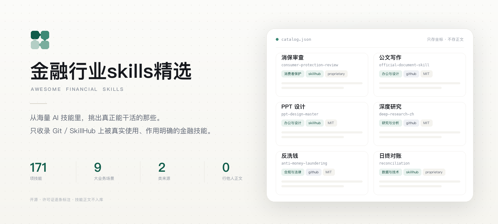
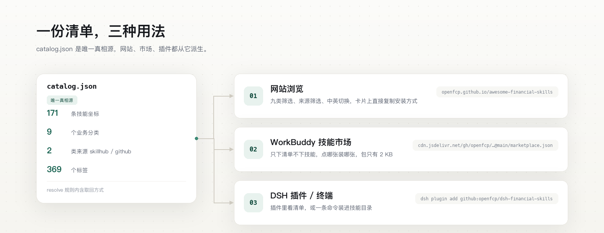
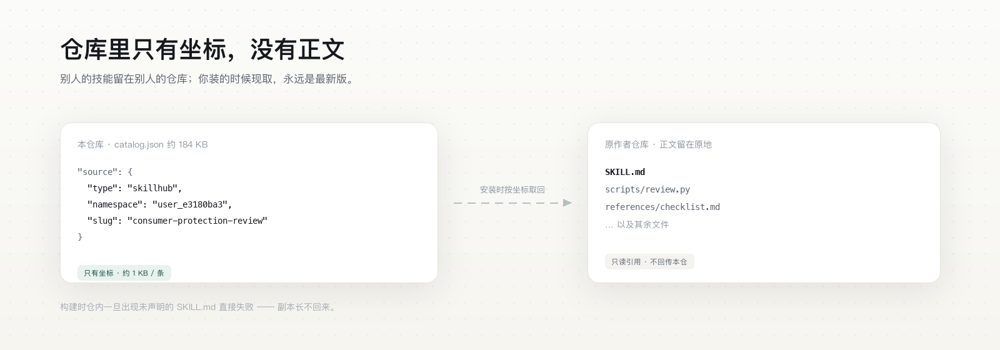

# 金融行业skills精选 · Awesome Financial Skills



<p>
  <a href="https://openfcp.github.io/awesome-financial-skills/"><b>→ 打开在线清单</b></a>　·　
  <a href="./catalog.json">catalog.json</a>　·　
  <a href="#怎么用">怎么用</a>　·　
  <a href="https://github.com/openfcp/awesome-financial-skills/issues/new?template=skill-submission.yml">推荐一个技能</a>
</p>

<p>
  
  
  
  
  
  <a href="https://github.com/openfcp/awesome-financial-skills/actions/workflows/validate.yml"></a>
</p>

AI 技能正在以周为单位膨胀。真正的问题早就不是「找不到」，而是**装完之后不敢用**——不知道它到底能干什么、边界在哪、出了问题谁负责。

这份清单只做一件事：把**被真实用过、作用明确、边界说得清**的金融技能挑出来，按九类业务场景摆好，标注来源、许可和安装方式。171 条，不多；但每一条都能追溯到原作者。

清单本身不是目的，**你打开就能用才是**。

---

## 为什么值得看

**挑过的，不是全量。** 不做技能热榜，只做一份可信的短名单。标题党、纯 prompt 合集、无法验证效果的营销材料，一律不收。

**边界写在明面上。** 每条都要求写清"不适用于什么场景、哪一步必须人来看"。金融业务里，一句"仅供参考"换不来合规。

**随时能取到最新版。** 仓库只存坐标，正文留在原作者那里。作者更新，你下次装到的就是新版——不存在"清单里是旧版本"这种事。

**来源与许可逐条标注。** MIT 110 条、proprietary 48 条、其他 13 条。谁的代码、能不能商用，不用你去猜。

---

## 它解决什么问题

| 你的困扰 | 这里怎么做 |
|---|---|
| 技能太多，标题一个比一个敢写，装完只会说套话 | 只收**对应具体岗位任务**的：消保审查、对账、KYC、投研问答、公文写作……泛化的"金融问答"不收 |
| 不知道能不能用在正式业务里 | 每条写清**能力边界与人工复核点**；涉及投资建议、征信、承保的必须标注 |
| 装完才发现是别人的付费内容被二次打包 | **零正文**：只记坐标，正文从原作者处取；许可逐条标注 |
| 今天收藏的链接，下个月打不开 | 每次发版**逐条验证引用可达**，失效即移除；PR 阶段 CI 也会真去上游取一次 |
| 装了一堆，实际只用两三个 | 九类场景 + 来源/许可筛选，按岗位找，而不是按热榜找 |

---

## 收录什么

不按 star 排名，但要求有真实使用痕迹。一条技能要进来，五条都得过：

1. **有真实使用痕迹** —— GitHub 上有实际提交与社区反馈，或已在 SkillHub 上架并被使用。纯营销页、无代码仓库的不收。
2. **作用明确** —— 说得出"哪个岗位、什么任务、省掉哪一步"，而不是"提升金融效率"。
3. **边界清楚** —— 写得出不适用于什么场景、哪一步必须人来看。
4. **来源可查** —— **SkillHub 优先**；同一技能两处都有，记 SkillHub 的坐标与版本，不另存副本。
5. **许可透明** —— 原件声明什么就记什么；没声明按 `proprietary` 记，不替作者猜。

**不收录**：纯 prompt 集合、无执行能力的角色扮演、无法验证效果的营销材料，以及**复制他人正文的二次打包**。

---

## 目录是怎么构成的

一份清单，两种来源，九类场景。`catalog.json` 是唯一真相源，网站、WorkBuddy 市场、DSH 插件都从它派生——所以你在哪一端看到的，都是同一批技能。



| 分类 | 条数 | 典型场景 |
|---|---:|---|
| 消费者保护 | 12 | 消保审查、营销物料合规、投诉处理 |
| 办公与设计 | 23 | 公文写作、PPT 与海报、报告排版 |
| 数据与技术 | 18 | 数据质量、对账、行情与参考数据 |
| 研究与分析 | 26 | 投研问答、深度研究、财报解读 |
| 合规与法律 | 21 | 反洗钱、适当性、合同审查、监管报送 |
| 风险管理 | 6 | 操作风险、流动性、对手方风险 |
| 投资与交易 | 18 | 组合与归因、交易执行、量化回测 |
| 产品与业务 | 28 | 客户经营、产品设计、提案生成 |
| 其他 | 19 | 尚未归入上述场景的工具 |

**来源**：GitHub 117 条 · SkillHub 54 条　　**最近核验**：2026-11-18

一条记录长这样——只有坐标，没有正文：

```json
{
  "id": "consumer-protection-review",
  "name": { "zh": "消保审查", "en": "Consumer Protection Review" },
  "category": "consumer-protection",
  "license": "proprietary",
  "source": { "type": "skillhub", "namespace": "user_e3180ba3", "slug": "consumer-protection-review" }
}
```

---

## 怎么用

四种方式，按你的习惯挑一个。**同一份清单，装的是同一批技能。**

### ① 在线浏览（最快）

**[openfcp.github.io/awesome-financial-skills](https://openfcp.github.io/awesome-financial-skills/)**

九类筛选、来源筛选、中英切换；卡片上标着许可与最近核验日期，右下角「安装 ▾」可直接复制对应运行环境的安装方式。不需注册，不需装任何东西。

### ② WorkBuddy：添加技能市场

技能 → 套件 → 右上角「添加市场」，市场源填：

```
https://cdn.jsdelivr.net/gh/openfcp/awesome-financial-skills@main/marketplace.json
```

添加时**只下载这份清单（约 123 KB）**，不会把 171 个技能全拉到你机器上。市场里出现 171 张卡，点哪张装哪张——每个包只有 2 KB 左右，首次使用时才从原作者处取回正文。

> 备用地址（raw，国内常整站超时，优先用上面那条）：
> `https://raw.githubusercontent.com/openfcp/awesome-financial-skills/main/marketplace.json`

### ③ DSH 插件

```bash
dsh plugin --profile desktop add github:openfcp/dsh-financial-skills
```

然后在 profile 的 `dsh.profile.bundles` 加入 `dsh-financial-skills`，彻底退出并重启 DSH，左侧栏会出现「金融技能」。插件实时读 `catalog.json`（TTL 6 小时，页脚可强制刷新）。

### ④ 终端一条命令

```bash
# 装全部（默认到 ~/.workbuddy/skills）
curl -fsSL https://raw.githubusercontent.com/openfcp/awesome-financial-skills/main/install.sh | bash -s -- --all

# 只装一个
python3 scripts/install.py --only law-skills
```

> 这是**终端命令**，不是「添加市场」的市场源。那个输入框只认仓库、zip 地址或本地路径。

---

## 仓库里为什么没有技能正文



上一版曾把 17 个技能完整复制进仓库：10 MB、555 个文件，与 SkillHub 原件字节级一致——也就是说这 10 MB 全是搬运。代价很直接：

- **必然过期**：作者更新后，仓库里的副本还是旧的，读者装到的是老版本；
- **版权不清**：正文版权属作者，清单只是索引，没有转授权；
- **体积失控**：每加一个技能就多一份正文，仓库迟早长成臃肿的镜像站。

现在每条形如上面那段 JSON：只记坐标，消费端按清单顶部的 `resolve` 规则回原件取。**构建时仓内一旦出现清单未声明的 `SKILL.md` 直接失败**——副本长不回来，靠的不是自觉，是构建。

---

## 我们怎么保证它不过期

一份长期维护的清单，可信度来自流程，不来自承诺：

- **每次发版逐条验活**：171 条引用全部回源取一次，取不到的当场暴露；
- **PR 阶段就有闸门**：格式、分类、许可字段、引用可达，CI 全自动校验，不合格进不了评审；
- **市场包有指纹**：每个包记录 `sha256`，发布后自动核对清单与包集合是否自洽；
- **变更全在公开历史里**：`catalog.json` 谁改的、什么时候改的，git 里查得到。

失效即移除，下架理由写在 PR 与 issue 里。

---

## 常见问题

<details>
<summary><b>装完技能以后，为什么第一次用还要跑 fetch.py？</b></summary>

WorkBuddy 市场里的包是「取件器」：只有 2 KB 的 `plugin.json` + `SKILL.md` + `fetch.py`，保证点装瞬间完成。第一次调用时按 `SKILL.md` 的指引跑一次 `fetch.py`，从原作者处取回正文。这样点装快、仓轻，也不会把别人的正文复制到你这台机器以外的任何地方。
</details>

<details>
<summary><b>技能会装到哪个目录？</b></summary>

默认 `~/.workbuddy/skills`（DSH 为 `~/.dsh/skills`）。目录名取 `SKILL.md` 里的 `name`，不是清单的 `id`——二者可能不同（例如 `id: ai-ppt-skill` → `name: ppt-master`），因为客户端按 `name` 触发技能。
</details>

<details>
<summary><b>作者更新了技能，我要重新装吗？</b></summary>

不用。清单里的 `version` 只是策展时的记录，实际每次取回的都是作者当前的版本。需要锁定某个 commit 时，GitHub 源的 `ref` 写成具体 sha。
</details>

<details>
<summary><b>WorkBuddy 市场里的卡片标题为什么是英文？</b></summary>

市场卡片的标题字段没有中文位，显示的是清单的 `name`（英文 id）。所以每张卡的描述开头都带 `【中文名】`，方便辨认。网站和 DSH 插件本来就用中文名当标题，不受影响。
</details>

<details>
<summary><b>某条链接失效 / 我是作者要求下架</b></summary>

提一条 [issue](https://github.com/openfcp/awesome-financial-skills/issues/new) 说明技能 id。链接失效的会在下次发版时移除；作者要求下架的，24 小时内移除清单条目与市场包。
</details>

---

## 许可与免责

清单内容采用 MIT。各技能正文版权归各自作者，遵循其仓库或 `SKILL.md` 的声明；来自 SkillHub 的技能以 SkillHub 上的许可为准。本清单是技术资源索引，不构成投资建议、法律意见或合规承诺；金融业务落地前请自行完成合规评估与人工复核。

---

## 参与贡献

发现了好用的金融技能？两条路，选顺手的：

<table>
<tr><td width="50%" valign="top">

**① 推荐一个技能**（不用改文件）

[](https://github.com/openfcp/awesome-financial-skills/issues/new?template=skill-submission.yml)

填：名称与链接、分类、一句话说明、**能力边界**、**实际使用情况**、开源协议。维护者审核后代录入清单。

</td><td width="50%" valign="top">

**② 直接提 PR**（会写 JSON 的话）

[](https://github.com/openfcp/awesome-financial-skills/compare)

一条 PR 只加一个技能，只改 `catalog.json`。CI 自动校验格式、分类、许可字段，并真去上游取一次正文。

</td></tr>
</table>

三条不放宽：**只写引用不搬正文**、**许可必须能说清**、**必须讲能力边界**。合并后由维护者统一重打包发布，「合并」到「出现在市场里」通常在同一天。

---

## 开发者文档

面向想看实现、要改代码或长期维护的人。日常使用可以到此为止。

**文档索引**

| 文档 | 内容 |
|---|---|
| [`ARCHITECTURE.md`](./ARCHITECTURE.md) | WorkBuddy 市场怎么工作、三种源格式、为什么这么设计、踩过的坑与决策日志 |
| [`MAINTAINING.md`](./MAINTAINING.md) | 新增 / 刷新 / 下架一条技能的命令与验收；别人提了 PR 怎么处理 |
| [`CONTRIBUTING.md`](./CONTRIBUTING.md) | 提交前自查、PR 规范、CI 会检查什么 |
| [`schema.json`](./schema.json) | `catalog.json` 的 JSON Schema，构建与 CI 都按它校验 |

<details>
<summary><b>目录结构</b></summary>

```
catalog.json          唯一真相源：分类 + 171 条技能引用（双语、来源、许可、安装方式、取回规则）
marketplace.json      WorkBuddy 市场清单（构建产物，171 条 archive 源，约 123 KB）
schema.json           catalog 的 JSON Schema
install.sh            一条命令安装的引导脚本
docs/                 GitHub Pages 站点
  index.html            单文件静态站（无外部依赖，file:// 也能打开）
  catalog.js            ← 构建产物，站点内嵌数据（带内容指纹）
  assets/               README 配图（由 scripts/make_readme_assets.py 生成）
scripts/
  install.py            读清单 → 回原件取正文 → 装进技能目录
  build.py              校验清单 + 生成 docs/catalog.js
  check_schema.py       按 schema.json 校验清单结构
  changed_ids.py        比对 base 提交，列出改动的条目（CI 用）
  add_skill.py          收录 / 修改一条技能
  pack_market.py        出市场包（默认全量取件器）
  publish_market.py     把包推到 marketplace 分支
  check_market.py       发布后验收：条数 / 包集合 / sha256
  check_clients.py      核对 raw 与各镜像、dsh 缓存看到的是哪一版
  sync.py               经 GitHub API 推送改动
  make_readme_assets.py 生成 README 三张配图
  release.sh            一键发布
```

</details>

<details>
<summary><b>本地命令</b></summary>

```bash
python3 scripts/check_schema.py       # 结构契约校验（需 jsonschema）
python3 scripts/build.py --check      # 业务规则 + 零正文守卫
python3 scripts/install.py --verify   # 逐条验证引用是否还取得到
python3 scripts/install.py --list     # 清单里有什么、本机装没装
npm run serve                         # 本地预览站点 http://localhost:8787
./scripts/release.sh "feat: …"        # 校验 + 验证 + 构建 + 推送
WITH_MARKET=1 ./scripts/release.sh    # 连带出包、发市场
```

改清单的流程永远是：**改 `catalog.json` → 跑 `release.sh`**。不要手改 `docs/catalog.js` 和 `marketplace.json`，它们是构建产物。

</details>

<details>
<summary><b>清单格式（format 3）</b></summary>

```json
{
  "source": { "type": "skillhub", "namespace": "user_xxx", "slug": "xxx" },
  "install": { "skillhub": "skillhub install xxx --namespace user_xxx" }
}
```

GitHub 源换成：

```json
{
  "source": { "type": "github", "repo": "owner/repo", "path": "skills/xxx", "ref": "main", "vendored": false },
  "install": { "plugin": "./skills/xxx" }
}
```

取回规则写在清单顶部的 `resolve` 里，消费端读它即可，不必硬编码地址：

```json
"resolve": {
  "skillhub": { "kind": "zip",   "url": "https://api.skillhub.cn/api/v1/download?slug={slug}" },
  "github":   { "kind": "files", "raw": "https://raw.githubusercontent.com/{repo}/{ref}/{path}",
                 "api": "https://api.github.com/repos/{repo}/contents/{path}?ref={ref}" }
}
```

`vendored: true` 只保留给"正文确实必须在本仓"的特例，当前没有这类条目。

</details>

<p align="center"><sub>清单 MIT · 技能正文版权归各作者 · 收录不等于背书</sub></p>
